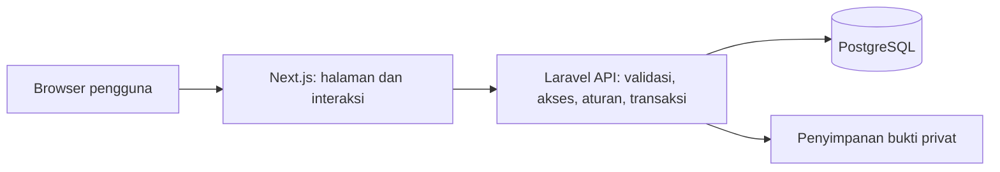

# Memahami source Lola Sport

[← README](../README.md) · [Mencoba aplikasi](PANDUAN-KELOMPOK.md) · [Mengubah bersama](../CONTRIBUTING.md)

## 1. Mulai dari tujuan

Proposal membahas pencatatan reservasi, pembayaran, dan pemantauan usaha. Pengguna mengizinkan eksperimen lokal memakai asumsi sementara. Kode adalah implementasi asumsi tersebut; hasil tes memeriksa perilakunya, bukan menggantikan persetujuan pengelola.

Urutan belajar: masalah → kebutuhan → batas → spesifikasi → alur dan rancangan data/UI → rencana/tugas → kode → pengujian → evaluasi manusia → serah terima. Ini urutan penjelasan, bukan klaim kronologi sempurna. Proposal memakai Waterfall; persetujuan tahap dan UAT akademik tidak dibuktikan oleh checklist AI.

Artefaknya:

- [PROJECT](PROJECT.md): tujuan dan batas; menjalankan sebagian fungsi PRD (dokumen kebutuhan produk).
- [DECISIONS](DECISIONS.md): keputusan; [DEMO-ASSUMPTIONS](DEMO-ASSUMPTIONS.md): aturan simulasi, bukan hasil wawancara baru.
- [Spec 001](../specs/001-demo/spec.md): kebutuhan, skenario dan acceptance criteria (kondisi hasil yang harus terpenuhi).
- [Plan 001](../specs/001-demo/plan.md) dan [tasks](../specs/001-demo/tasks.md): cara teknis dan pekerjaan.
- [Model data](../specs/001-demo/data-model.md): entitas/hubungan secara tekstual, bukan diagram ERD formal terpisah.
- [Kontrak API](../specs/001-demo/contracts/api.md): alamat, data dan hasil komunikasi antarlapisan.
- [Spec 002](../specs/002-mobile-redesign/spec.md): kebutuhan UX mobile; [plan](../specs/002-mobile-redesign/plan.md) memuat susunan layar dan token desain. Tidak ada wireframe terpisah yang diklaim selesai.
- [STATE](STATE.md) dan laporan verification tiap tahap: pemeriksaan yang dilaporkan, kegagalan/perbaikan dan batasnya. Centang tugas tidak menggantikan bukti.

## 2. Siapa mengerjakan apa?

Next meneruskan `/api/v1/*` dan `/sanctum/*` ke Laravel melalui [next.config.ts](../apps/web/next.config.ts). Browser tidak menulis langsung ke database. Pemeriksaan frontend memberi petunjuk; keputusan akhir tetap backend.

Autentikasi berarti mengenali akun. Session/cookie mengingat keadaan login. Otorisasi menentukan tindakan yang boleh dilakukan. Sanctum dan CSRF melindungi alur first-party; tidak ada bearer token login di localStorage. Pemilik hanya mendapat laporan, bukan otomatis seluruh hak pegawai.

Docker menjalankan PostgreSQL pada setup ini. Dependency dipasang oleh npm/Composer sesuai lockfile. `.env` menyimpan konfigurasi/rahasia per komputer; source dan database adalah hal berbeda. Git merekam perubahan lokal; GitHub membagikannya setelah push.

AGENTS.md, skill, MCP Boost/Context7 dan Spec Kit membantu agen/pengembang. Itu bukan komponen yang diperlukan pelanggan saat memesan; akun AI tidak diperlukan untuk menjalankan alur aplikasi. Adanya konfigurasi MCP tidak membuktikan koneksinya sedang aktif.

## 3. Peta file yang berguna

- [Halaman Next](../apps/web/src/app): folder route seperti `reservasi/[id]/page.tsx` memberi URL detail; Back/refresh tidak lagi bergantung pada satu state halaman.
- [Komponen](../apps/web/src/components): `catalog`, `auth`, `checkout`, `bookings`, `payments`, `staff`, `master`, `reports`; `shell/common` dipakai bersama.
- [Helper API dan tipe](../apps/web/src/app/lib.ts): format Rupiah/WIB, data, cookie CSRF dan pesan HTTP.
- [CSS](../apps/web/src/app/globals.css): token dan layout responsif.
- [Route Laravel](../apps/api/routes/api.php): pintu permintaan.
- [Controllers](../apps/api/app/Http/Controllers): validasi input dan pemanggilan service; `ReportController` menyusun penerimaan.
- [BookingService](../apps/api/app/Services/BookingService.php): `locked`, `expire`, `create`, `submit`, `review`, `cancel`, `audit`.
- [BookingPolicy](../apps/api/app/Policies/BookingPolicy.php): kepemilikan dan peran.
- [Models](../apps/api/app/Models), [migration](../apps/api/database/migrations), [seeder](../apps/api/database/seeders/DatabaseSeeder.php): data, struktur dan isi awal.
- [scripts/project.mjs](../scripts/project.mjs): launcher/setup/check/tes; [bootstrap](../scripts/bootstrap.ps1): dependency/runtime Windows.
- [Tes backend](../apps/api/tests), [tes browser](../tests/e2e), [CI](../.github/workflows/check.yml): pemeriksaan otomatis. CI adalah workflow GitHub, bukan deployment.

## 4. Ikuti satu reservasi sampai laporan

Contoh seed: futsal satu jam Rp150.000, DP Rp75.000. Semua endpoint di bawah berawalan `/api/v1`.

1. **Pilih jadwal** — `catalog.tsx` mengambil `GET /courts?date=...`. `CourtController::index` mengambil lapangan aktif dan slot dari database. Pilihan tanggal/lapangan/jam/durasi ada di URL, belum menahan slot. Publik tidak mendapat identitas pelanggan.
2. **Login** — `auth.tsx` mengirim `POST /login`; `AuthController` memeriksa akun dan memperbarui session. Tujuan checkout dipertahankan. Login tidak otomatis memesan.
3. **Konfirmasi** — `checkout.tsx` mengambil ulang jadwal/harga lalu mengirim `POST /bookings`. `BookingController` dan `BookingService::create` memeriksa peran, data, waktu mendatang, jam buka, lapangan aktif dan overlap. Harga dihitung backend dan disimpan pada transaksi. Booking menjadi `pending` dengan tenggat.
4. **Ajukan DP** — `payments.tsx` mengirim nominal/metode/file ke `POST /bookings/{id}/payments`. `PaymentController` memeriksa akses, integer, MIME/extension dan batas 2 MB. `submit` memeriksa DP/sisa/tenggat/pengajuan lain. Pembayaran `pending`, booking awal `review`; nilai diterima masih nol.
5. **Pegawai memutuskan** — antrean mengarah ke `/pegawai/verifikasi/{id}`. `POST /payments/{id}/review` hanya untuk pegawai. `review` mengunci transaksi, memastikan pengajuan belum diputuskan dan total tidak berlebih. Approved DP mengonfirmasi booking; penolakan awal membatalkan/melepas slot. Alasan penolakan wajib.
6. **Pelunasan** — pengajuan berikut harus tepat sisa, lalu diverifikasi. DP approved + pelunasan approved membuat status pembayaran `paid`. Tunai hanya dicatat pegawai dan langsung approved dengan audit.
7. **Pemilik membaca** — `GET /reports?from=...&to=...` hanya untuk pemilik. Approved dijumlahkan berdasarkan `reviewed_at` WIB. DP dan pelunasan masing-masing dihitung sekali; kategori memakai seluruh riwayat approved agar pelunasan tidak berubah menjadi DP ketika filter menyembunyikan pembayaran awal.

Kegagalan adalah bagian alur: 401 sesi tidak berlaku; 403 tidak berwenang; 409 konflik keadaan/slot; 419 masalah sesi/CSRF; 422 input tidak sah. UI memberi pemulihan, backend tetap menolak tindakan yang tidak sah.

## 5. Aturan yang paling penting dipahami

**Bentrok:** dua browser dapat melihat slot kosong bersamaan. Service memakai transaksi dan penguncian court → booking → payment. PostgreSQL juga mempunyai exclusion constraint pada rentang aktif. `[mulai, selesai)` berarti 10–11 dapat disusul 11–12, tetapi 10–12 tidak dapat bertumpuk dengan 11–12. Lihat [migration domain](../apps/api/database/migrations/2026_10_18_032243_create_demo_domain.php).

**Status berbeda:** booking `pending/review/confirmed` menahan slot; `cancelled/expired` melepasnya. Pengajuan pembayaran `pending/approved/rejected`. Ringkasan pembayaran `unpaid/partial/paid` dihitung dari approved. Booking confirmed belum tentu lunas.

**Expiry:** hitung mundur mengacu waktu server. Hold pending yang lewat dilepas saat jadwal/riwayat/operasi terkait diakses; bukan klaim ada scheduler yang selalu berjalan tepat pada detik tenggat. Bukti tepat waktu tetap menahan slot selama review.

**Privat:** bukti diambil melalui endpoint berotorisasi, bukan URL storage publik. Contoh PNG unduhan merupakan file fiktif publik, berbeda dari unggahan privat pengguna.

**Uang/waktu:** nilai disimpan sebagai integer rupiah, DP dibulatkan ke atas. Harga transaksi tidak mengikuti perubahan master setelah dipesan. Timestamp memakai UTC; input, tampilan dan batas tanggal laporan memakai Asia/Jakarta.

**Penerimaan bukan total booking:** reservasi Rp150.000 dengan DP approved Rp75.000 menghasilkan penerimaan Rp75.000. Sisa belum diterima. Jika pelunasan disetujui besok, nilainya masuk besok. Pembatalan tanpa refund tetap mempertahankan approved. Ini bukan laba dan dasar “omzet” sebenarnya perlu validasi pengelola.

**Audit:** perubahan penting mencatat pelaku/waktu. Ini membantu penelusuran, bukan klaim audit independen atau sistem produksi kebal manipulasi.

## 6. Dari mana tahu hasilnya benar?

[Test domain](../apps/api/tests/Feature/DemoTest.php) memeriksa akses, bentrok, expiry, nominal, file, pembatalan dan laporan. [Tes konkurensi](../apps/api/tests/Concurrency/ConcurrencyTest.php) memakai dua proses independen. [Tes kontrak redesign](../apps/api/tests/Feature/RedesignContractTest.php) memeriksa informasi slot/clock dan kategori laporan. [E2E](../tests/e2e/demo.spec.ts) mengikuti tindakan browser sampai rekonsiliasi; [edge cases](../tests/e2e/redesign.spec.ts) memeriksa konflik, error dan layout.

Tes fungsi menjawab apakah perilaku sesuai ekspektasi. Screenshot membantu memeriksa tampilan. Tes kegunaan membutuhkan manusia mencoba tugas. UAT membutuhkan penilaian pengguna berwenang terhadap kebutuhan yang disepakati. Dua hal terakhir belum digantikan pemeriksaan agen.

AI dapat menulis kode dan tes dengan asumsi salah yang sama. Selalu bandingkan dengan kebutuhan, hitungan acuan, dan masukan pengelola; jangan hanya menghitung jumlah tes lulus.
